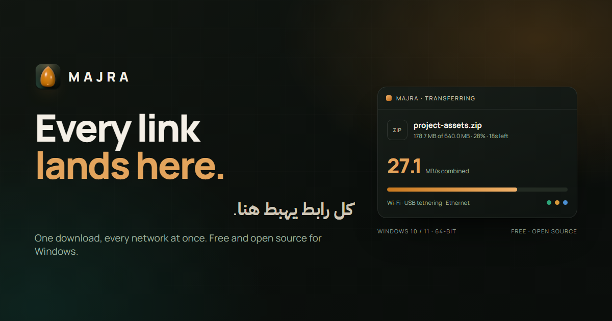
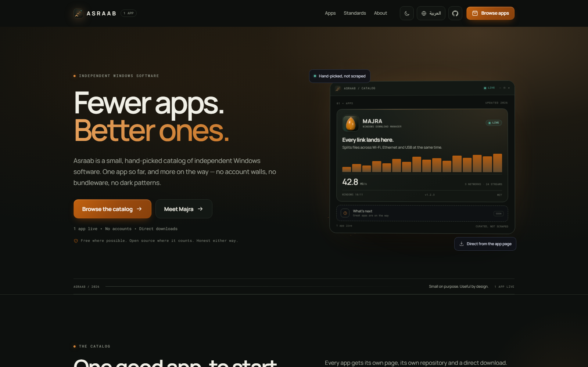
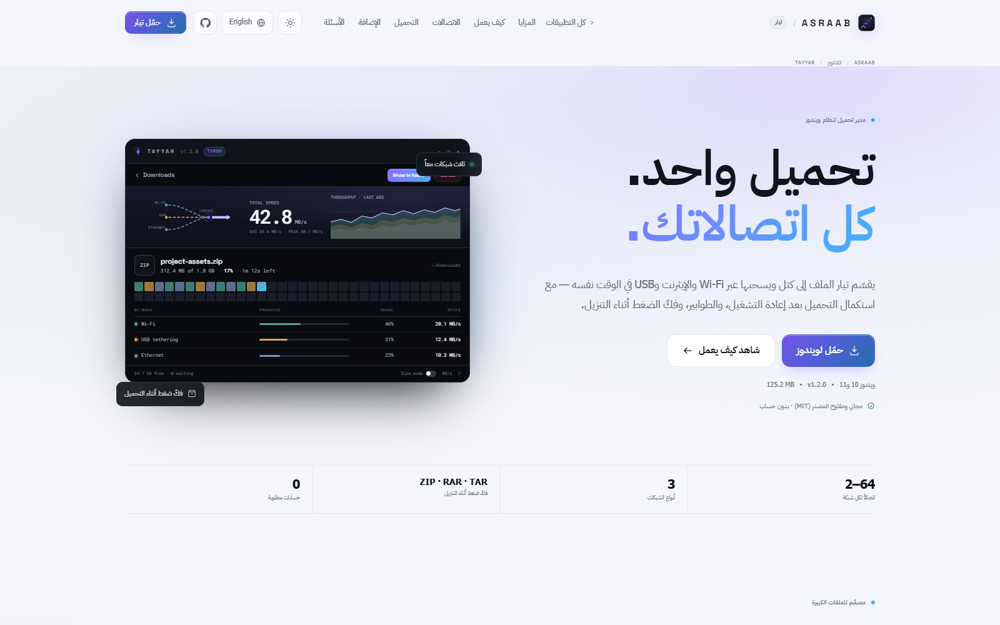
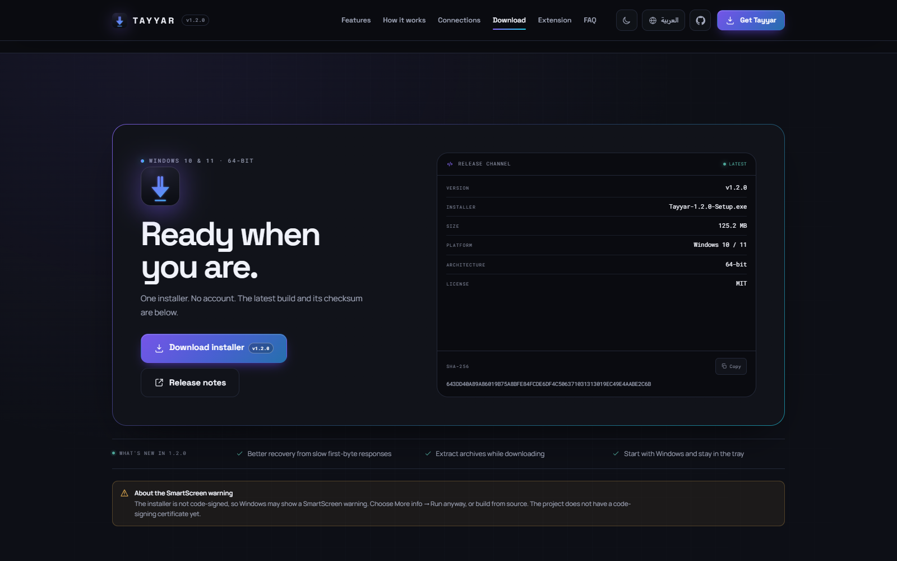
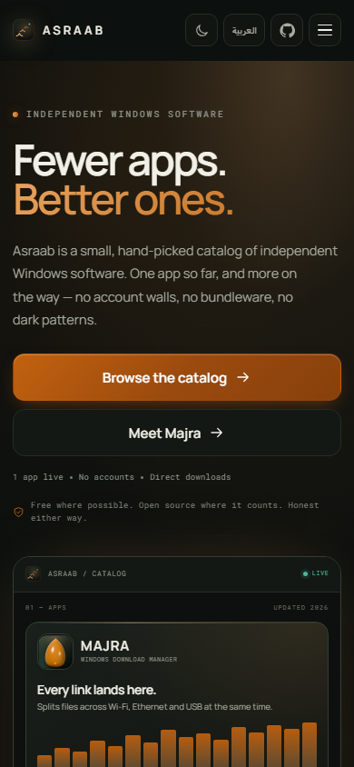
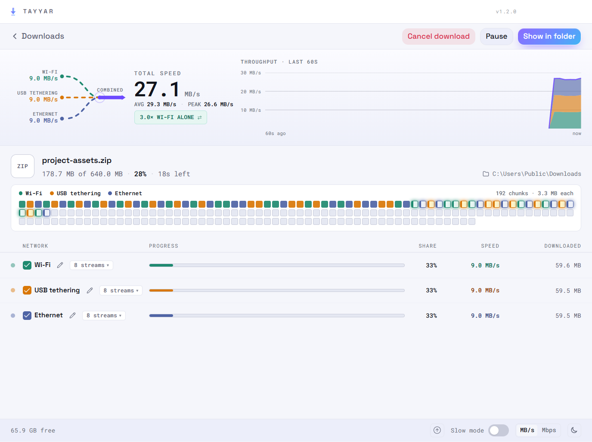

<p align="center">
  
</p>

<h1 align="center">Tayyar</h1>

<p align="center">
  <strong>Every connection. One download.</strong><br />
  A free, open-source Windows download manager that puts Wi-Fi, Ethernet, USB tethering and mobile data to work on the same file.
</p>

<p align="center">
  <a href="https://bouadjadjatamer2-hub.github.io/tayyar-download-manager-/"> Part of <strong>Asraab</strong></a> — a small, hand-picked catalog of independent Windows apps.
</p>

<p align="center">
  <a href="https://github.com/bouadjadjatamer2-hub/tayyar-download-manager-/releases/download/v1.2.0/Tayyar-1.2.0-Setup.exe"></a>
  <a href="https://bouadjadjatamer2-hub.github.io/tayyar-download-manager-/"></a>
  <a href="LICENSE"></a>
</p>

<p align="center">
  <a href="https://bouadjadjatamer2-hub.github.io/tayyar-download-manager-/">Asraab</a> ·
  <a href="https://bouadjadjatamer2-hub.github.io/tayyar-download-manager-/apps/tayyar/">Tayyar page</a> ·
  <a href="https://github.com/bouadjadjatamer2-hub/tayyar-download-manager-/releases/download/v1.2.0/Tayyar-1.2.0-Setup.exe">Download</a> ·
  <a href="https://github.com/bouadjadjatamer2-hub/tayyar-download-manager-/releases/download/v1.2.0/Tayyar-Browser-Extension.zip">Browser extension</a> ·
  <a href="https://github.com/bouadjadjatamer2-hub/tayyar-download-manager-/releases/tag/v1.2.0">Release notes</a> ·
  <a href="https://github.com/bouadjadjatamer2-hub/tayyar-download-manager-/issues">Issues</a>
</p>

<a href="https://bouadjadjatamer2-hub.github.io/tayyar-download-manager-/"></a>

Tayyar splits files into blocks and binds each stream to a network interface, so a download can use Wi-Fi, Ethernet and USB tethering at the same time. It also resumes interrupted transfers, schedules downloads, extracts archives while they arrive, captures links from the browser, handles torrents, and can scan finished files with Windows Defender.

Tayyar is a fork of [Plexo](https://github.com/anmolkapil/plexo) (MIT), rebuilt as a Windows desktop app and extended for maximum throughput. See [NOTICE.md](NOTICE.md) for what changed.

> [!NOTE]
> “Every connection” means every network interface Windows exposes. Tayyar cannot create bandwidth that is not there: two connections behind the same router often share one uplink, and servers without byte-range support fall back to a single stream.

Asraab is a curated, owner-maintained catalog. There is no public submission form, account system or web admin panel. Adding an app is a maintainer-only change to [`docs/assets/apps.js`](docs/assets/apps.js) plus a page under `docs/apps/<slug>/`. The homepage’s “coming soon” card is editorial, not an invitation to submit an app.

---

## Screenshots

### The website

The [Asraab catalog](https://bouadjadjatamer2-hub.github.io/tayyar-download-manager-/) is bilingual and theme-aware. The [Tayyar page](https://bouadjadjatamer2-hub.github.io/tayyar-download-manager-/apps/tayyar/) keeps the installer, extension ZIP and checksum together, and sends both downloads straight to your browser — no release-page detour.

[](https://bouadjadjatamer2-hub.github.io/tayyar-download-manager-/)

<table>
  <tr>
    <td width="50%" valign="top">
      <a href="https://bouadjadjatamer2-hub.github.io/tayyar-download-manager-/apps/tayyar/"></a>
    </td>
    <td width="50%" valign="top">
      <a href="https://bouadjadjatamer2-hub.github.io/tayyar-download-manager-/apps/tayyar/#download"></a>
    </td>
  </tr>
  <tr>
    <td align="center"><sub>Arabic · light theme</sub></td>
    <td align="center"><sub>Direct download</sub></td>
  </tr>
</table>

<p align="center">
  <a href="https://bouadjadjatamer2-hub.github.io/tayyar-download-manager-/"></a><br />
  <sub>Mobile</sub>
</p>

### The app

[](docs/screenshots/app-detail.png)

<sub>Captured from the real app; the three network interfaces are simulated for the screenshot. One file, three connections, one progress bar.</sub>

---

## What it does

### Use every connection

- **Interface-bound streams.** Each worker is bound to one network interface, so Wi-Fi, Ethernet, USB tethering and mobile data can feed the same download at once.
- **Dynamic segmentation.** Starts at 8 streams per network and grows to 32 while the server and disk keep up. Turbo mode goes further, with up to 64 streams per network and 4 MB blocks.
- **A shared work queue.** Faster networks take more blocks automatically instead of waiting for a slower one.
- **Range-aware fallback.** If a server does not support byte ranges, Tayyar uses a single connection instead of pretending to split the file.

### Built to finish

- **Resume across restarts** and sleep/wake, with per-block checkpoints and an expired-link replacement flow that does not throw away downloaded bytes.
- **Version checks.** ETag and Last-Modified validation stop a file republished mid-download from being stitched together from two versions.
- **Safe publish.** Data is written to a preallocated staging file and only moved to the final name after validation, so a half-finished download never looks complete.
- **Any size.** A 1 KB file and a multi-terabyte archive take the same path; there is no minimum or maximum download size.
- **Extract while downloading.** ZIP, RAR and TAR archives — including `.tar.gz`, `.tar.bz2` and `.tar.xz` — unpack as they arrive, avoiding a second full-size copy on disk.
- **Optional Windows Defender scan** of each finished file.
- **Automatic updates.** Packaged builds check GitHub Releases at launch and every few hours, then download a newer version in the background and install it on restart.

### Stay in control

- Queues, concurrent-download limits, per-network speed caps and daily/weekly/monthly data budgets.
- Download schedules by time and day, plus automatic categories for Video, Audio, Programs, Documents, Archives and Images.
- Arabic and English, with a fully right-to-left Arabic layout, Arabic plurals and dates, and a one-click switch that survives a restart.
- Clipboard capture, tray support, start with Windows, and optional shutdown when the queue finishes.
- Browser handoff with cookies included, so signed-in downloads work.
- Torrents from magnet links or `.torrent` files, with the same queue and history.

---

## How it works

1. **Probe the link.** Tayyar reads the response headers, filename, size, range support and validators.
2. **Plan the blocks.** The file becomes a queue of byte ranges sized for the connection and disk.
3. **Bind and pull.** Each request is bound to a chosen interface. Streams grow when the server and disk keep up, and slow blocks are raced near the end.
4. **Assemble and publish.** Blocks land in a preallocated staging file, get verified, and are renamed only after the download is whole.

When an archive is being extracted, completed blocks are fed to the extractor as soon as their data is available. The download and extraction share the same progress state, so pause, resume and cancel still behave normally.

---

## Download

**Windows 10 / 11 · 64-bit · v1.2.0 · 125.8 MB**

[**Download Tayyar-1.2.0-Setup.exe**](https://github.com/bouadjadjatamer2-hub/tayyar-download-manager-/releases/download/v1.2.0/Tayyar-1.2.0-Setup.exe) · [Release notes](https://github.com/bouadjadjatamer2-hub/tayyar-download-manager-/releases/tag/v1.2.0) · [All releases](https://github.com/bouadjadjatamer2-hub/tayyar-download-manager-/releases)

|                      |                                     |
| -------------------- | ----------------------------------- |
| **Version**          | 1.2.0                               |
| **Platform**         | Windows 10 / 11, 64-bit             |
| **Installer**        | `Tayyar-1.2.0-Setup.exe` · 125.8 MB |
| **License**          | MIT                                 |
| **Account required** | No                                  |

### What's new in 1.2.0

- Extract ZIP, RAR and TAR archives while downloading.
- Start with Windows and stay in the tray.
- Better recovery from slow first-byte responses.

> [!WARNING]
> The installer is not code-signed, so Windows SmartScreen may show a warning. Choose **More info → Run anyway**, or build from source. The project does not have a code-signing certificate yet.

<details>
<summary>Verify the SHA-256 checksum</summary>

```powershell
Get-FileHash .\Tayyar-1.2.0-Setup.exe -Algorithm SHA256
```

Expected:

```text
C0E5D52718B1728C5250D95135140078A80CFE706D359D74574D14EDC354FA63
```

</details>

---

## Browser extension (optional)

[**Download Tayyar-Browser-Extension.zip**](https://github.com/bouadjadjatamer2-hub/tayyar-download-manager-/releases/download/v1.2.0/Tayyar-Browser-Extension.zip) · [Privacy policy](https://bouadjadjatamer2-hub.github.io/tayyar-download-manager-/extension/privacy/)

The Chromium extension hands downloads to Tayyar with the browser's cookies, so signed-in files work. It supports Chrome, Edge, Brave and Opera.

1. Download the ZIP and extract it somewhere you will remember.
2. Open your browser's extensions page — `chrome://extensions` in Chrome, `edge://extensions` in Edge.
3. Turn on **Developer mode**, choose **Load unpacked**, and select the extracted folder. `manifest.json` sits at its root.
4. Keep Tayyar running, then use the toolbar button or the right-click menu.

> [!NOTE]
> This is a manual install and is not on the Chrome Web Store yet, so the browser will not update it automatically. Re-download the ZIP when a new release lands. The extension only talks to Tayyar on `127.0.0.1`; there are no developer servers.

---

## Privacy

There is no account, no advertising and no analytics. Tayyar talks only to the URLs you give it, and the extension talks only to the app on your computer. Download history and settings stay on your PC. The [extension privacy policy](https://bouadjadjatamer2-hub.github.io/tayyar-download-manager-/extension/privacy/) has the details.

---

## Build from source

**Requirements:** Node.js 22+ and npm 9+. Build the Windows installer on Windows.

```powershell
git clone https://github.com/bouadjadjatamer2-hub/tayyar-download-manager-.git
cd tayyar-download-manager-
npm ci
npm run dev
```

Create the Windows installer:

```powershell
npm run build:win
```

The installer is written to `dist/` and is unsigned unless you provide signing credentials. Build the browser extension with:

```powershell
npm run build:extension
```

That writes `extension/dist/chrome` and `extension/dist/firefox`. Before opening a pull request, run:

```powershell
npm run lint
npm run typecheck
npm run format:check
```

The desktop app is Electron + React + TypeScript. The browser extension is Manifest V3, the site is static HTML/CSS/JS in `docs/`, and Playwright end-to-end tests live in `e2e/`.

---

## Contributing

Issues and pull requests are welcome. Read [CONTRIBUTING.md](CONTRIBUTING.md) for setup and test commands, open an issue before a large change, and describe the network setup you tested — which interfaces, URL and file size.

---

## Credits

Tayyar is a fork of [Plexo](https://github.com/anmolkapil/plexo) by Anmol Kapil, used under the MIT License. Plexo's copyright and permission notice are retained in [LICENSE](LICENSE); the changes made for Tayyar are listed in [NOTICE.md](NOTICE.md).

Bundled tools and their licenses — including UnRAR and `unzipper` — are also listed in [NOTICE.md](NOTICE.md). Not affiliated with, endorsed by, or derived from Internet Download Manager (Tonec Inc.).

## License

[MIT](LICENSE) © 2026 Tayyar contributors.

---

<h2 dir="rtl" align="right">بالعربية</h2>

<p dir="rtl" align="right">
  <strong>تيار</strong> مدير تحميل مجاني ومفتوح المصدر لنظام ويندوز 10/11. يوزّع الملف الواحد على Wi-Fi والإيثرنت وUSB في الوقت نفسه، مع استئناف التحميل بعد إغلاق التطبيق، والجدولة، واستخراج الأرشيف أثناء التنزيل، والتقاط الروابط من المتصفح.
</p>

<p dir="rtl" align="right">
  <a href="https://bouadjadjatamer2-hub.github.io/tayyar-download-manager-/">موقع أسراب</a> ·
  <a href="https://bouadjadjatamer2-hub.github.io/tayyar-download-manager-/apps/tayyar/">صفحة تيار</a> ·
  <a href="https://github.com/bouadjadjatamer2-hub/tayyar-download-manager-/releases/download/v1.2.0/Tayyar-1.2.0-Setup.exe">تحميل الإصدار 1.2.0</a> ·
  <a href="https://github.com/bouadjadjatamer2-hub/tayyar-download-manager-/releases/download/v1.2.0/Tayyar-Browser-Extension.zip">إضافة المتصفح</a>
</p>

<p dir="rtl" align="right">تيار هو أول تطبيق في كتالوج أسراب، والمزيد في الطريق. الموقع متوفر بالعربية والإنجليزية.</p>
